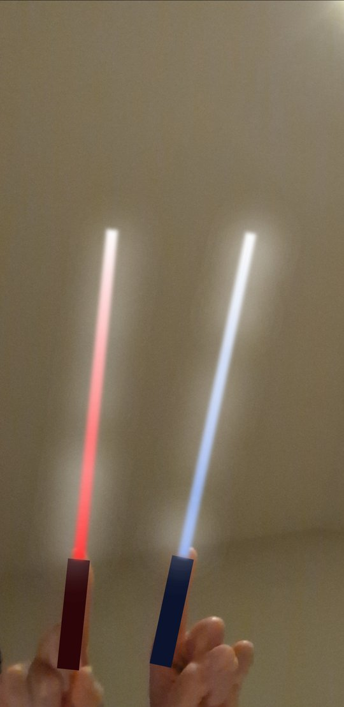

# Laser Bird

Laser Bird is an Android app that tracks your hand through the front camera
and draws an animated laser effect, with sound, that follows it.

Hand tracking uses the [MediaPipe Hand Landmarker](https://ai.google.dev/edge/mediapipe/solutions/vision/hand_landmarker)
task. The app started as a fork of Google's
[HandLandmarker Android example](https://github.com/google-ai-edge/mediapipe-samples/tree/main/examples/hand_landmarker/android);
see [NOTICE](NOTICE) for attribution. This project is not affiliated with or
endorsed by Google.

<p align="center">
  
</p>

## Building

Requirements:

* Android Studio (or the Android SDK plus a JDK 17+ for command-line builds)
* A physical Android device running Android 7.0 (API 24) or later

Open this directory in Android Studio and click Run, or from the command line:

```bash
./gradlew installDebug
```

The `hand_landmarker.task` model is downloaded into `app/src/main/assets/`
automatically on the first build by `app/download_tasks.gradle`.

## License

Apache License 2.0; see [LICENSE](LICENSE) and [NOTICE](NOTICE).
